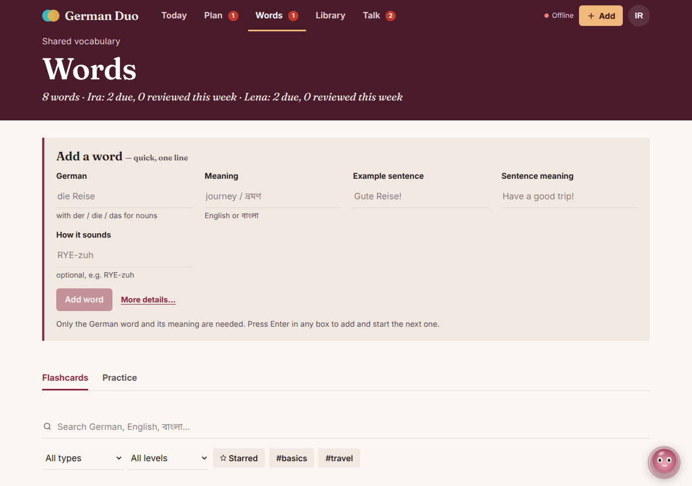
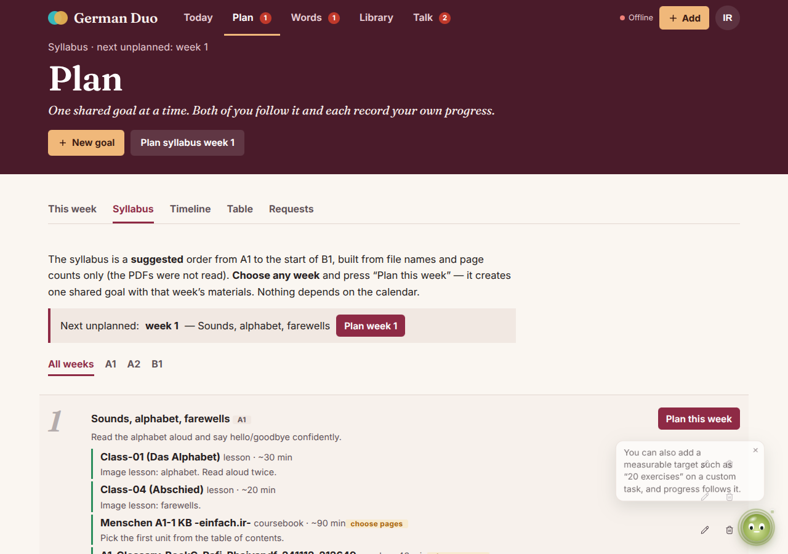
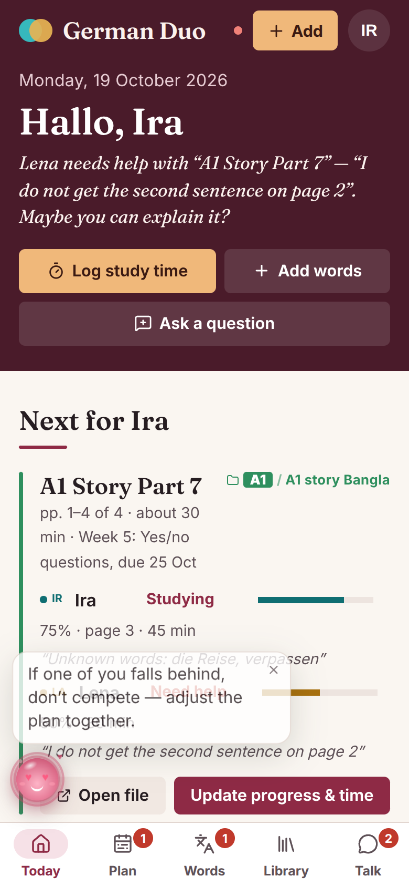

# German Duo

A calm, shared German-learning dashboard for **two learners**. Both follow the same goals, each records their own progress, and everything either of you does is visible, logged and reversible. Built with React, Vite, TypeScript and Supabase.

| Today | Words: quick add + flashcards | Syllabus: pick any week |
|---|---|---|
|  |  |  |

| Update progress & time (a full page) | Phone | Dark |
|---|---|---|
|  |  |  |

*(Screenshots use demo data and made-up names.)*

## Features
- **Today** – what to study next with one button, both people side by side (last login, last update, progress, minutes, study days), a road from A1 to B1, a study-day heat map, minutes per week, latest changes.
- **Update progress & time in one step** – choose Not started / Studying / Finished / Need help, tap the page you reached, tap the minutes, add a note, **Save**. A stopwatch is optional. Undo appears right after.
- **Plan** – *This week*, **Syllabus** (52 suggested weeks; you pick *any* week and press "Plan this week" — nothing depends on the calendar), *Timeline* (Gantt with both people's progress in every bar), *Table*, *Requests* (postpone only with the other person's approval).
- **Words** – add a word in one line (word, meaning, example sentence, its meaning, how it sounds), then see it as a **flashcard**: tap to flip, hear it read aloud (device voice), star it, practise with spaced repetition. Shared, with each person's review state visible.
- **Library** – your 121-file inventory with original folders and page counts; files without a saved link open the shared Drive folder plus a name search.
- **Talk** – Chat, Notes & questions, Notices in one place. **History** – every change with before → after, Revert/Restore. Bubbles on tabs show what the other person changed.
- **Quick tasks are overlays, big tasks are pages** – logging time, asking a question, updating progress, notices, links and postponing open as a small sheet over what you were doing (you keep your context). Only the long ones — the goal editor, a goal's details and the full word form — are full pages, with a Back arrow; the phone/browser Back button closes them.
- **Installable app (PWA)** – add to the home screen on Android, iOS and desktop: own icon, splash screen (iOS splash images for 12 device sizes, Android splash from the manifest), full-screen, fixed header and bottom bar, no rubber-band scrolling, works offline for the app shell.
- **Lumi, the study helper** – a small round orb with a face (eyes follow your pointer) that you can drag anywhere, that reacts to the tab you open, typing, coming back to the window and being left alone, speaks 100+ tips and observations about your real progress, and answers "What should I do now?".

## What's new in v1.1
- **Your own % on every task** – in *Update progress & time* choose “Set the % myself” (0–100). It replaces the page count until you clear it; *Finished* is always 100%. Tasks without pages (a link, a video…) are measured only this way.
- **“Ready for questions” badge** – when a task is *Finished* you can switch on “Ready for questions”: you finished it properly, so the other person may ask about it. The badge shows next to *Completed* everywhere.
- **Plan → Weekly table** – one block per week: week number, deadline, exam session date (set by hand), then every book/PDF with each person's stage and %, who finished first, and who is ready for questions. *Options & postpone* is on every week.
- **Tasks for one person** – in the goal editor choose “Who is this task for?” → *Only IR* / *Only LA*. It counts only for that person (progress, “goal done”, Today).
- **Hover colours fixed** – selected chips/buttons keep readable colours on hover, and hover colours no longer stick after a tap on a phone.

> **Already running v1.0?** Run `sql/4_upgrade_v1_1.sql` once in the Supabase SQL Editor *before* using this version (it only adds columns; nothing is deleted). Fresh installs get it automatically through `sql/1_setup.sql`.

## Quick start
Requirements: Node 22 and a free [Supabase](https://supabase.com) project.

```bash
git clone https://github.com/<you>/german-duo.git && cd german-duo
npm install
cp .env.example .env      # fill in the values below
npm run dev               # http://localhost:5173
```

### 1. Supabase (browser only, ~10 min)
1. **SQL Editor → New query**: run `sql/1_setup.sql`, then `sql/2_library_and_curriculum.sql`. (`1_setup.sql` first clears this app's tables from an older version; Auth users are untouched.)
2. **Authentication → Users → Add user** (tick *Auto Confirm User*): one user per learner. **The password is the access key.**
3. Run `sql/3_add_learners.sql` (edit the two emails in it first if yours differ). It must list two rows.
4. **Authentication → Sign In / Providers → Email**: turn **off** "Allow new users to sign up" and "Confirm email".
5. **Project Settings → API**: copy the *Project URL* and the *anon public* key (never the service-role key).

### 2. Environment variables
| Variable | Meaning |
|---|---|
| `VITE_SUPABASE_URL` | Project URL |
| `VITE_SUPABASE_ANON_KEY` | anon public key (safe for the browser; Row Level Security protects the data) |
| `VITE_LEARNER_EMAILS` | the two login emails, first = IR, second = LA. Only the key is typed in the app. |
| `VITE_DRIVE_ROOT_URL` | optional, shared Google Drive root folder (a default is built in) |

## Install on your phone
Open the deployed site (HTTPS) on the phone → **Android/Chrome**: menu → *Install app*. **iPhone/iPad/Safari**: Share → *Add to Home Screen*. The app also shows an install banner and an *Install app* entry in the account menu.
Icons and splash screens are generated by `python3 scripts/make-icons.py` (needs Pillow); the generated files are already in `public/`.

## Deploy on Vercel
1. Import the repo. Framework **Vite**, build `npm run build`, output `dist` (already in `vercel.json`).
2. Add the three required variables above under *Settings → Environment Variables*, then redeploy.
3. The build runs `scripts/clean-stale.mjs` first, which deletes files left over from older versions of this project, so a half-updated repo cannot break it.

## End-to-end tests (optional)
`e2e/` contains a click-through of every function in real Chromium against a *mocked* Supabase (78+ checks: what you see and what each action sends to the database). It has its own `package.json` so Vercel never installs a browser:
```bash
npm run dev                        # or: npm run build && npm run preview
cd e2e && npm install && BASE=http://localhost:5173 npm test
```
(Start the app with `VITE_SUPABASE_URL=https://demo.supabase.co VITE_SUPABASE_ANON_KEY=demo-anon-key-demo-anon-key-123 VITE_LEARNER_EMAILS=ir@demo.test,la@demo.test`.)

## Scripts
| Command | What it does |
|---|---|
| `npm run dev` / `build` / `preview` | develop, production build, serve the build |
| `npm run typecheck` / `lint` / `test` | TypeScript, ESLint, Vitest (components, domain logic, markup-nesting guard) |
| `npm run check` | all of the above plus the build |
| `npm run test:db` | SQL security tests on a **local** PostgreSQL (`scripts/test-db.sh`) |
| `npm run gen:library` | regenerate seeds from `data/library-tree.txt` and `data/curriculum.mjs` |

## Architecture
```
src/
  pages/        Today, Plan (+ Syllabus), Words, Library, Talk (Chat, Notes, Notices), History, Settings
  components/   FormPage (full-page forms), Page (cover band), UpdateDialog, MaterialCard, Syllabus, Gantt, GoalEditor, charts, Shell …
  pet/          Orb, tips (117), observations of your data, draggable dock + helper menu
  hooks/        auth, realtime, theme, toast, undo-aware run(), tab bubbles
  api/          typed Supabase queries and mutations
  lib/domain/   pure, tested logic: progress, spaced repetition, gantt layout, change-log helpers
sql/            three files to paste into the Supabase SQL editor (built from supabase/migrations)
supabase/       migrations and SQL security tests
```
- **Auth:** the access key is the password of one of two Supabase Auth users; the app tries both. Supabase hashes it and rate-limits guessing.
- **Data:** shared goals; one progress row per person per material; per-person study sessions and review schedules, all visible to both.
- **Security:** Row Level Security on every table. Each person can write only their own progress/time/review rows; deadlines move only through request → approval; the change log is written by triggers and cannot be edited by clients.
- **Undo:** a trigger records every change (before/after, who, when). `revert_change()` puts it back and is itself logged.
- **Realtime:** one channel per user; offline banner and automatic refetch on reconnect.

## Troubleshooting
- **Access key not recognised** – the user's password differs, or `VITE_LEARNER_EMAILS` doesn't match the two emails. Restart `npm run dev` after editing `.env`.
- **"This account is not a registered learner"** – run `sql/3_add_learners.sql`.
- **Vercel: `Module … has no exported member`** – old files from a previous version are in your repo: `git rm src/components/resource.tsx src/hooks/useResourceActions.ts src/lib/domain/stats.test.ts`.
- **`Failed to resolve import "@fontsource/…"`** – run `npm install`.
- **Not updating live** – the header should say *Live*.

## Honest notes
The curriculum is a proposal from file names and page counts (no PDF was read). Google Drive links are checked for shape only. Stopwatch time is elapsed time since Start, labelled as such. Edits are not queued offline.

## Look & feel
"Study journal" look: a deep-crimson cover band on every page, then open paper with lists, rules and big numerals (no boxed dashboard widgets), tonal buttons, underlined form fields. Inter for text and Fraunces (editorial serif) for headings, thin scrollbars, light and dark. All colours and fonts are CSS variables at the top of `src/styles/app.css`.
