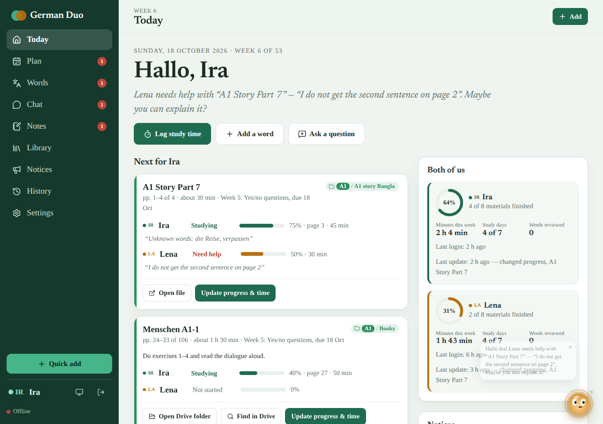
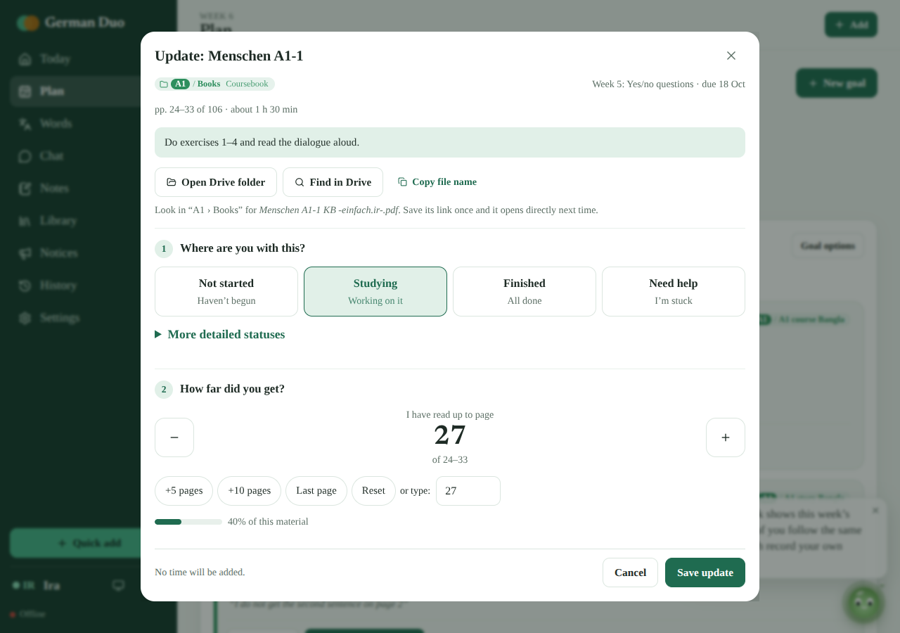
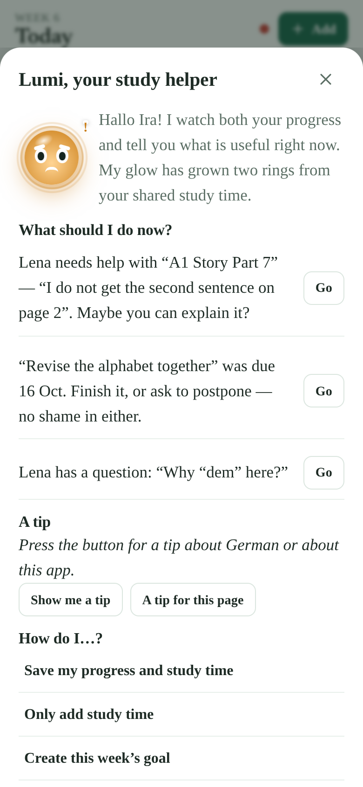
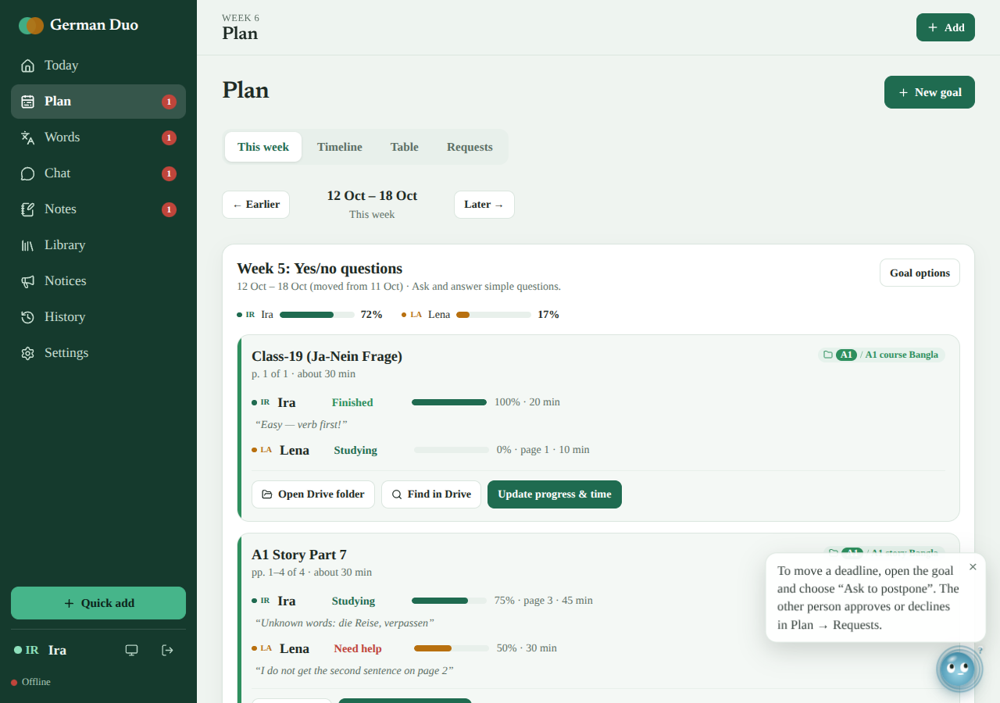
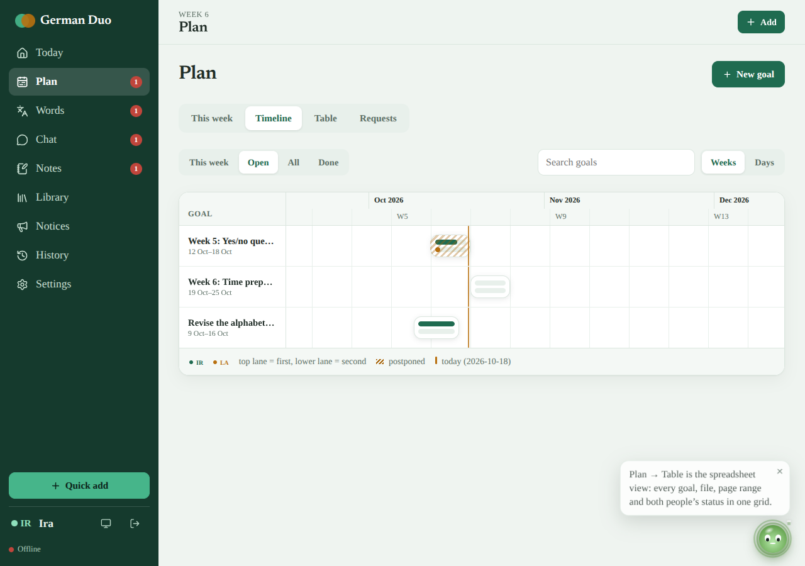
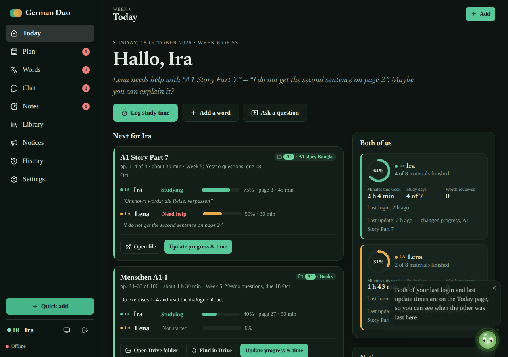

# German Duo

A calm, shared German-learning dashboard for **two learners**. Both follow the same goals, each records their own progress, and everything either of you does is visible, logged and reversible. Built with React, Vite, TypeScript and Supabase.

| Today | Update progress & time | The study helper |
|---|---|---|
|  |  |  |

| Plan | Timeline | Dark |
|---|---|---|
|  |  |  |

*(Screenshots use demo data and made-up names.)*

## Features
- **Today** – what to study next with one button, both people side by side (last login, last update, progress, minutes, study days), a road from A1 to B1, a study-day heat map, minutes per week, latest changes.
- **Update progress & time in one step** – choose Not started / Studying / Finished / Need help, tap the page you reached, tap the minutes, add a note, **Save**. A stopwatch is optional. Undo appears right after.
- **Plan** – *This week* (plain list), *Timeline* (Gantt with both people's progress in every bar), *Table* (goal → file sheet), *Requests* (postpone only with the other person's approval).
- **Library** – your 121-file inventory with original folders, page counts and a 52-week suggested curriculum (inferred from file names only). Files without a saved link open the shared Drive folder plus a name search.
- **Words** – shared vocabulary with article, plural, English and Bangla, spaced-repetition review for each person.
- **Notes & questions, Chat, Notices**, light/dark/system theme, animated splash screen.
- **History** – every change with before → after; **Revert** or **Restore**. Red bubbles on tabs show what the other person changed since you last looked.
- **Lumi, the study helper** – a small round orb with a face (eyes that follow your pointer, a mouth, brows) that you can drag anywhere (or dock in a corner, or move with the arrow keys). It shows 14 moods through eyes, mouth, colour and motion, reacts to the tab you open, to typing in a form, to you coming back to the window and to being left alone, drifts on its own, speaks 100+ tips and observations about your real progress, answers "What should I do now?" and "How do I…?", gains glowing rings as you study together, and can be silenced or hidden.

## Quick start
Requirements: Node 22 and a free [Supabase](https://supabase.com) project.

```bash
git clone https://github.com/<you>/german-duo.git && cd german-duo
npm install
cp .env.example .env      # fill in the values below
npm run dev               # http://localhost:5173
```

### 1. Supabase (browser only, ~10 min)
1. **SQL Editor → New query**: run `sql/1_setup.sql`, then `sql/2_library_and_curriculum.sql`. (`1_setup.sql` first clears this app's tables from an older version; Auth users are untouched.)
2. **Authentication → Users → Add user** (tick *Auto Confirm User*): one user per learner. **The password is the access key.**
3. Run `sql/3_add_learners.sql` (edit the two emails in it first if yours differ). It must list two rows.
4. **Authentication → Sign In / Providers → Email**: turn **off** "Allow new users to sign up" and "Confirm email".
5. **Project Settings → API**: copy the *Project URL* and the *anon public* key (never the service-role key).

### 2. Environment variables
| Variable | Meaning |
|---|---|
| `VITE_SUPABASE_URL` | Project URL |
| `VITE_SUPABASE_ANON_KEY` | anon public key (safe for the browser; Row Level Security protects the data) |
| `VITE_LEARNER_EMAILS` | the two login emails, first = IR, second = LA. Only the key is typed in the app. |
| `VITE_DRIVE_ROOT_URL` | optional, shared Google Drive root folder (a default is built in) |

## Deploy on Vercel
1. Import the repo. Framework **Vite**, build `npm run build`, output `dist` (already in `vercel.json`).
2. Add the three required variables above under *Settings → Environment Variables*, then redeploy.
3. The build runs `scripts/clean-stale.mjs` first, which deletes files left over from older versions of this project, so a half-updated repo cannot break it.

## Scripts
| Command | What it does |
|---|---|
| `npm run dev` / `build` / `preview` | develop, production build, serve the build |
| `npm run typecheck` / `lint` / `test` | TypeScript, ESLint, Vitest (components, domain logic, markup-nesting guard) |
| `npm run check` | all of the above plus the build |
| `npm run test:db` | SQL security tests on a **local** PostgreSQL (`scripts/test-db.sh`) |
| `npm run gen:library` | regenerate seeds from `data/library-tree.txt` and `data/curriculum.mjs` |

## Architecture
```
src/
  pages/        Today, Plan, Words, Notes, Chat, Library, Notices, History, Settings
  components/   UpdateDialog, MaterialCard, Gantt, GoalEditor, charts, ChangeList, Shell …
  pet/          Orb, tips (117), observations of your data, draggable dock + helper menu
  hooks/        auth, realtime, theme, toast, undo-aware run(), tab bubbles
  api/          typed Supabase queries and mutations
  lib/domain/   pure, tested logic: progress, spaced repetition, gantt layout, change-log helpers
sql/            three files to paste into the Supabase SQL editor (built from supabase/migrations)
supabase/       migrations and SQL security tests
```
- **Auth:** the access key is the password of one of two Supabase Auth users; the app tries both. Supabase hashes it and rate-limits guessing.
- **Data:** shared goals; one progress row per person per material; per-person study sessions and review schedules, all visible to both.
- **Security:** Row Level Security on every table. Each person can write only their own progress/time/review rows; deadlines move only through request → approval; the change log is written by triggers and cannot be edited by clients.
- **Undo:** a trigger records every change (before/after, who, when). `revert_change()` puts it back and is itself logged.
- **Realtime:** one channel per user; offline banner and automatic refetch on reconnect.

## Troubleshooting
- **Access key not recognised** – the user's password differs, or `VITE_LEARNER_EMAILS` doesn't match the two emails. Restart `npm run dev` after editing `.env`.
- **"This account is not a registered learner"** – run `sql/3_add_learners.sql`.
- **Vercel: `Module … has no exported member`** – old files from a previous version are in your repo: `git rm src/components/resource.tsx src/hooks/useResourceActions.ts src/lib/domain/stats.test.ts`.
- **`Failed to resolve import "@fontsource/…"`** – run `npm install`.
- **Not updating live** – the header should say *Live*.

## Honest notes
The curriculum is a proposal from file names and page counts (no PDF was read). Google Drive links are checked for shape only. Stopwatch time is elapsed time since Start, labelled as such. Edits are not queued offline.

## Look & feel
Deep-green palette (light and dark), a Times-style serif (Tinos) for all text and the editorial serif Newsreader for hero headings, thin scrollbars, soft cards. All colours and fonts are CSS variables at the top of `src/styles/app.css`.
